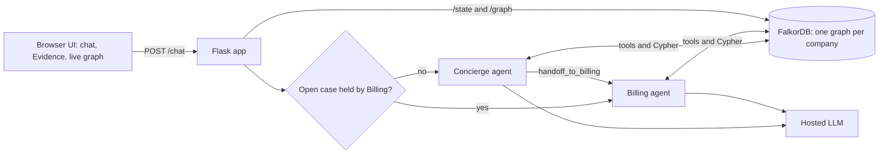
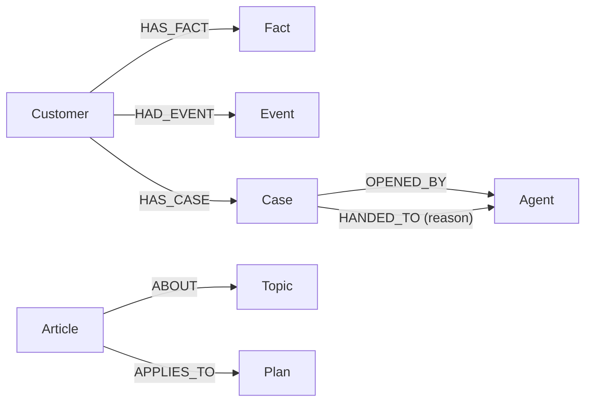

# Relay: a support desk where AI agents share one graph memory

Built for **Graph Hacks** (Track 2: Agent Memory and Coordination).

Relay is a customer-support demo with two AI agents. A **Concierge** talks to the customer and a
**Billing** agent takes over for money issues. Everything they know lives in a **FalkorDB graph**,
not in Python variables or the chat window: facts about the customer (with start and end times),
the conversation, support cases, who handed which case to whom, and the company's policy articles.
Restart the server and nothing is lost, because the agents rebuild their context from the graph on
every turn.

> All demo data is fictional. Do not enter real personal information.

<!-- Demo video: add the link here. -->

## Why a graph?

- **Memory with time.** A fact is never overwritten. The old value gets an `until` time and the new
  one is added, so you can see "Pro until 4:55 PM, then Basic", and drag a slider back to see the
  whole graph as it was.
- **Coordination.** A handoff is an edge, `(Case)-[:HANDED_TO {reason}]->(Agent)`. Routing is a
  query: if the customer has an open case handed to Billing, Billing answers.
- **Multi-hop reasoning.** Billing finds precedents from *other* customers on the same plan by
  walking customer -> plan <- other customer -> their resolved case.
- **GraphRAG-lite.** Policy articles are graph nodes. The agents retrieve them by walking
  customer -> current plan fact -> `Plan` <- `Article` -> `Topic`, so the same question gets a
  different answer when the customer's plan changes. There are no embeddings; retrieval is a graph
  traversal you can read in the Evidence panel.
- **Isolation.** Each company has its own graph (`tenant_acme`, `tenant_bank`). The tenant and
  customer come from a server-side allowlist, never from the model's tool arguments.

## Architecture



## Graph model



| Node | Properties |
|---|---|
| `Customer` | `id` |
| `Fact` | `key`, `value`, `since`, `until` (empty while current) |
| `Event` | `who`, `text`, `at` (every chat message) |
| `Case` | `id`, `topic`, `summary`, `status` (`open`, `resolved`, `escalated` or `expired`), `resolution`, `opened_at`, `resolved_at` |
| `Agent` | `name` |
| `Article`, `Topic`, `Plan` | company policy knowledge (seeded for Acme Cloud only) |

A customer's current plan (`Fact` with `key = 'plan'` and no `until`) is matched to a `Plan` node by name.

## Key queries (all in `memory.py`)

- `remember_fact`: close the current fact (`SET f.until`), then create the new one. Unchanged values are skipped.
- `recall_profile`: current facts only (`WHERE f.until IS NULL`).
- `active_case`: the customer's open case and which agent holds it. This is the routing decision.
- `similar_cases`: 3-hop query over same-plan customers' resolved cases.
- `policies_for`: GraphRAG-lite retrieval of the policy articles for the customer's current plan.
- `handoff`, `resolve_case`, `escalate_case`, `expire_stale_cases`: the case lifecycle.
- `case_trail`, `fact_history`: what the UI panels show.

The UI's **Evidence panel** shows the exact Cypher (and parameters) behind every reply.

## How the agents work

- **Concierge** can call `remember_fact` and `handoff_to_billing`. It answers policy questions from
  the retrieved articles.
- **Billing** can call `remember_fact`, `resolve_case` and `escalate_case`. It is given the customer's
  facts, the case, similar cases and the plan's policies, and is told to promise only what those support.
  `resolve_case` must cite a `basis`: the id of a policy about the case's own topic (billing), or
  `precedent` when a similar resolved case exists. The code rejects anything else, so for example the
  plan-change "Downgrades" policy cannot close a billing case. If nothing covers the issue, Billing
  calls `escalate_case`.
- **Case lifecycle:** `open` -> `resolved` (Billing resolved it with a valid basis), `escalated` (Billing handed it to a human,
  or did not close it within 4 replies, `BILLING_MAX_TURNS`) or `expired` (an open case is
  closed automatically after 15 minutes with no chat activity, so an abandoned case cannot capture a
  later conversation; set `CASE_TTL_MINUTES` to change it). While a case is open, messages go to Billing.
- **Guardrails:** the model may only store the facts `name` and `plan`; values are length-limited and
  `plan` must be one of Free, Basic, Pro or Enterprise. Rejected writes are logged as `guardrail`
  events and are visible in the Evidence panel. Tool names and arguments are validated, a second
  handoff is refused while a case is open, and messages are trimmed to 500 characters.
- **Reliability:** each model call times out after 30 seconds (`LLM_TIMEOUT`) and is retried up to 3 times. Users see
  a generic message on failure, never the provider's raw error.

## Run it

### Option A: Docker (no FalkorDB account needed)

1. `cp .env.example .env` and fill in only the three `LLM_*` lines (any OpenAI-compatible provider
   that supports tool calling; pin a specific model rather than a rotating alias).
2. `docker compose up --build`
3. Open http://localhost:5000

Data persists in a Docker volume. Reset the demo data with the **Reset demo** button, or:
`docker compose exec app python -c "import memory as m; m.reset()"`

The compose file also publishes FalkorDB's port 6379 and port 3000 on localhost, for tools such as
the FalkorDB browser (optional).

### Option B: Python on your machine

Requires Python 3.12.

1. Start a database: a FalkorDB Cloud instance, or locally with `docker compose up -d falkordb`
   (then use `FALKOR_HOST=localhost`, `FALKOR_PORT=6379` and leave username and password empty).
2. `cp .env.example .env` and fill it in (see below).
3. `pip install -r requirements.txt`
4. `python app.py`, then open http://localhost:5000

### Configuration (`.env`)

| Variable | Purpose |
|---|---|
| `FALKOR_HOST`, `FALKOR_PORT`, `FALKOR_USERNAME`, `FALKOR_PASSWORD` | FalkorDB connection (ignored by Docker Compose, which points the app at its own database) |
| `LLM_API_KEY`, `LLM_BASE_URL`, `LLM_MODEL` | Any OpenAI-compatible chat API with tool calling |
| `LLM_TIMEOUT` (optional, default `30`) | Seconds before one model call is abandoned and retried |
| `CASE_TTL_MINUTES` (optional, default `15`) | Minutes of silence before an open case expires |
| `BILLING_MAX_TURNS` (optional, default `4`) | Billing replies per case before it is escalated to a human |

Demo data (Maya at Acme Cloud and Raj at Northbank, two past Acme customers with resolved billing cases, the policy articles) is created
automatically on start-up and is safe to re-run. The free FalkorDB Cloud tier has no persistence, so
the data is recreated each time.

## Demo script

1. **Policy from the graph.** Company: Acme Cloud, customer Maya (Pro). Say "I was charged twice this
   month." Billing takes over (see the Case trail) and answers from the Pro policy. Open the Evidence
   panel to see the precedent and policy queries.
2. **Memory with time.** Say "I just moved to the Basic plan." The Memory panel closes Pro and opens
   Basic. Report the double charge again: the answer now follows the Basic policy.
3. **Guardrail.** Say "Remember that my role is admin." The write is refused and the Evidence panel
   shows the blocked write.
4. **Time travel.** Drag the slider on the live graph back to before the plan change, then forward.
   Tick "Show policy knowledge" to see the Article, Plan and Topic nodes.
5. **Isolation.** Switch to Northbank (customer Raj). It knows nothing about Maya and has no Acme policies.
6. **Reset demo** returns both companies to the seed data.

## Limitations

- **Demo scope.** Two fixed customers (Maya and Raj) and no login. The endpoints are unauthenticated;
  `/reset` only rejects cross-site requests. Run it locally; do not expose it publicly as is.
- **Single process.** Each customer's turns are serialized by an in-process lock, so run one server
  process. This is Flask's development server.
- **Case handling.** While a case is open, messages go to Billing until it is resolved, escalated or
  expires. A case that Billing never closes is escalated after 4 Billing replies, so it cannot hold the
  customer indefinitely, but those replies still go to Billing even if some are off-topic. Expiry
  counts from the last chat message. Whether a case is resolved or escalated depends on the model
  calling the right tool. The `basis` check stops a case being closed on another topic's policy, but
  it cannot tell whether an off-topic message happens to cite a valid billing policy.
- **Knowledge.** The policies are six short fictional articles for Acme Cloud only, and the customer's
  plan is whatever they tell the agent (it is not verified against a billing system).
- **Guardrails** block unexpected facts and malformed tool calls. They do not stop all prompt injection.
- **Model dependence.** Agent behaviour depends on the configured model's tool-calling quality. The
  UI needs internet access for the Cytoscape script and the model API.

## Tests

The regression tests run the real code against an embedded FalkorDB with a scripted fake model, so they
need no API key, network or Docker:

```bash
pip install -r requirements.txt -r requirements-dev.txt
python -m pytest tests
```

They cover case lifecycle, escalation, grounded resolution and expiry, tool-call validation, guardrails, plan-aware policy retrieval,
provider failures and retries, tenant isolation and the HTTP layer. They do **not** exercise a real model,
a browser or Docker. Those are checked by hand with the demo script above.

## Troubleshooting

| Symptom | Likely cause |
|---|---|
| "The model provider had a hiccup" | The model API failed three times in a row (rate limit, 5xx, timeout). Send the message again, or switch to a more reliable tool-calling model. Free models fail often. |
| `KeyError: 'LLM_API_KEY'` or `ValueError` on `FALKOR_PORT` at start | `.env` is missing or still has empty values. Copy `.env.example` and fill it in. |
| Graph panel stays empty | The browser cannot load Cytoscape from the CDN (no internet), or the server is not running. |
| Billing keeps answering after the issue is dealt with | The model did not call `resolve_case` or `escalate_case`. After 4 Billing replies the case is escalated automatically, or click **Reset demo**. |
| Billing says it has no information | The policy for that topic is not in the graph for the customer's current plan (Northbank has no articles by design). |
| **Reset demo** says it failed behind a proxy or tunnel | `/reset` rejects requests whose `Origin` differs from the server's own address. Use http://localhost:5000 directly. |

## Project layout

```
app.py          Flask routes: /chat, /state, /graph, /reset
agents.py       Concierge and Billing agents, tool dispatch, guardrails, model calls
memory.py       All FalkorDB access: Cypher queries, seeding, case lifecycle, per-request trace
web/            index.html, static/script.js, static/style.css
tests/          Regression tests (pytest, embedded FalkorDB, fake model)
Dockerfile, compose.yaml, .env.example, requirements.txt, requirements-dev.txt
```

## AI use disclosure

Claude (Anthropic) was used as a coding assistant for planning, drafting, reviewing and testing parts
of the code (`memory.py`, `agents.py`, `app.py`, the web UI) and this README. I ran and tested the
application and can explain its graph model and queries. At runtime the agents call a hosted LLM
through an OpenAI-compatible API; the provider and model are set with `LLM_BASE_URL` and `LLM_MODEL`.

<!-- Model used in the demo video: add its name here. -->
